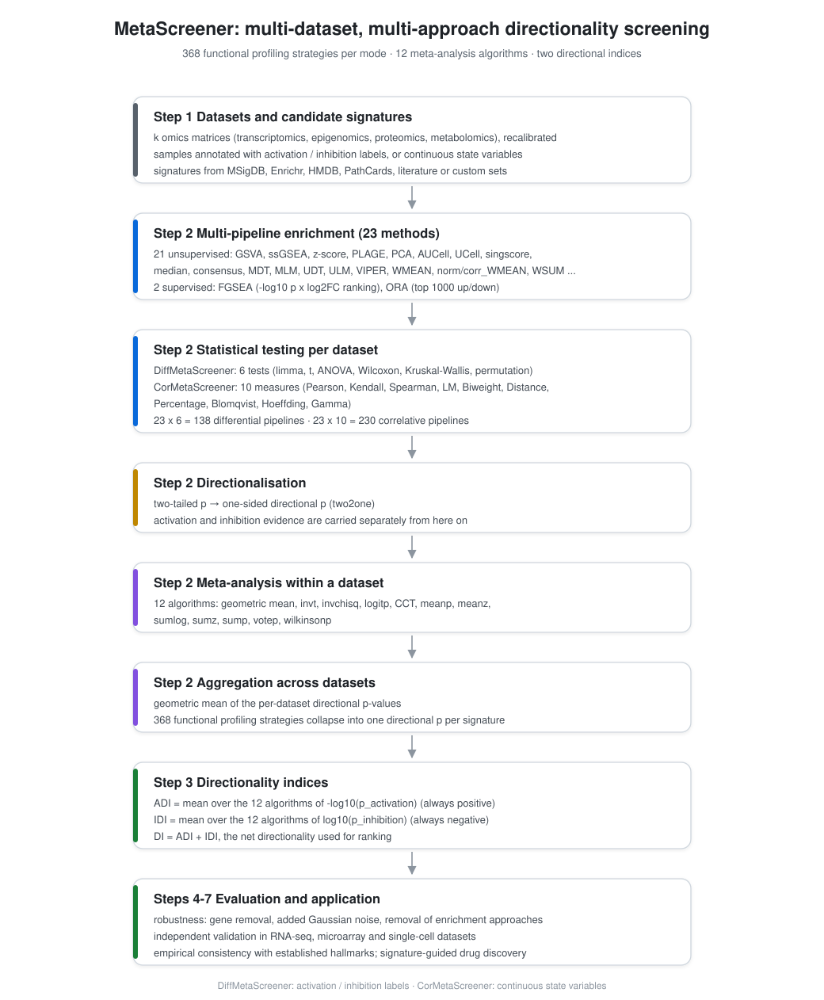

# MetaScreener

**Directional meta-analysis of gene-set activity across multiple datasets and
independent enrichment methods.**

[](LICENSE)
[](https://cran.r-project.org)

Most signature-screening tools answer *whether* a gene set is associated with a
phenotype. MetaScreener answers *in which direction*, and how consistently:
each signature receives an **Activation Direction Index (ADI)** and an
**Inhibition Direction Index (IDI)**, aggregated over many datasets and many
enrichment methods, instead of a single p-value that hides the sign of the
effect.



## Why a directional index

A conventional meta-analysis of gene sets collapses two questions into one. If a
signature is strongly activated in half the cohorts and strongly inhibited in
the other half, its combined p-value can look impressive while the biology is
contradictory. MetaScreener keeps the two directions apart at every step:

1. activity is quantified per sample with a panel of scoring methods;
2. the group difference (or the association with a continuous variable) is
   tested per dataset;
3. each two-sided p-value is split into one-sided **activation** and
   **inhibition** evidence, according to the sign of the effect;
4. the evidence is combined across methods within a dataset, then across
   datasets, with twelve p-value combination strategies;
5. the mean of the log-transformed combined evidence becomes ADI and IDI.

The result is a ranked, direction-aware shortlist: a signature with high ADI and
near-zero IDI behaves as a consistent activation marker, one with high |IDI| and
near-zero ADI as a consistent inhibition marker, and a signature with both large
is context-dependent.

## Installation

```r
if (!requireNamespace("BiocManager", quietly = TRUE)) install.packages("BiocManager")
install.packages("remotes")

remotes::install_github("IOBR/IOBR")          # not on CRAN or Bioconductor
BiocManager::install(c("GSVA", "GSEABase", "AUCell", "singscore", "UCell",
                       "decoupleR", "clusterProfiler", "limma", "fgsea"),
                     update = FALSE)
install.packages(c("metap", "doBy", "dplyr", "plyr", "reshape2"))

remotes::install_github("FangZY-Lab/MetaScreener")
library(MetaScreener)
```

The first installation takes 15–40 minutes because of the Bioconductor
dependency stack. New to the package? Start with the
**[step-by-step tutorial](TUTORIAL.md)**.

## Quick start

```r
library(MetaScreener)

data("example_geneset")      # 10 signatures
data("example_diffgroup")    # per-dataset comparison table
data(list = c("diffGSE33113", "diffGSE33113_G",
              "diffGSE35896", "diffGSE35896_G",
              "diffGSE13067", "diffGSE13067_G"))

res <- DiffMetaScreener(
  expression_accession_vector = c("diffGSE33113", "diffGSE35896", "diffGSE13067"),
  comparisons                 = example_diffgroup,
  geneSets_gmt                = example_geneset,
  enrichment_method           = c("zscore_t", "zscore_wilcoxon"),
  min.sz = 2,
  max.sz = 10000
)

res[order(-res$ADI), ]
```

```text
     signatures         ADI           IDI
4     FLIER_WNT 18.74944260 -6.136770e-06
1  BIOCARTA_WNT 12.01998509 -2.179156e-02
6  HALLMARK_WNT 11.14547430 -2.411874e-03
10       WP_WNT  7.31220985 -3.819236e-02
7      KEGG_WNT  6.16164280 -2.953711e-01
3   FEVR_WNT_UP  5.30784588 -3.516706e-02
9  REACTOME_WNT  1.23345962 -5.840720e-02
5      GOBP_WNT  0.57010137 -1.005907e+00
8       PID_WNT  0.09815316 -1.713012e+00
2   FEVR_WNT_DN  0.01452660 -8.911991e+00
```

`FLIER_WNT` is activated across all three cohorts, `FEVR_WNT_DN` is inhibited
(IDI −8.9 with an ADI near zero), and `PID_WNT` / `GOBP_WNT` carry both signs
and are flagged as context-dependent.

## The two modes

| Mode | Function | Phenotype | Per-dataset test |
| --- | --- | --- | --- |
| differential | `DiffMetaScreener()` | two-group labels (`Tag`, `group`) | t, limma, ANOVA, Wilcoxon, permutation, Kruskal–Wallis |
| correlation | `CorMetaScreener()` | continuous score (`Tag`, `value`) | Pearson, Spearman, Kendall, linear model, biweight, distance, percentage, Blomqvist, Hoeffding, gamma |

## Method space

| Layer | Options |
| --- | --- |
| scoring | GSVA, ssGSEA, z-score, PLAGE, PCA, AUCell, UCell, singscore, MEDIAN, FGSEA, ORA, consensus, MDT, MLM, UDT, ULM, VIPER, WMEAN, WSUM (plus normalised and correlation-weighted variants) |
| p-value combination | geometric mean, inverse t, inverse chi-square, logit, Cauchy (CCT), meanp, meanz, sumlog, sumz, sump, votep, Wilkinson |
| aggregation | mean of log₁₀ combined evidence across combination strategies |

An `enrichment_method` value names a scoring family and a test, joined by an
underscore: `gsva_wilcoxon`, `singscore_limma`, `aucell_permutation`,
`zscore_pearson`. Roughly a hundred combinations are available per mode.

> **Note on small k.** `meanp` and `meanz` require at least four valid p-values
> at *both* combination steps. If you restrict `p_combine_method` to them while
> using few methods or few datasets, they return `NA`, the pipeline substitutes
> 1, and every ADI/IDI collapses to zero. The function warns when this is about
> to happen; keeping the default (all twelve strategies) avoids it entirely.

## Input contract

Objects are looked up **by name** in the calling environment:

| Object | Content |
| --- | --- |
| `<id>` | expression matrix, genes × samples, log2 scale, unique gene symbols |
| `<id>_G` (Diff) | data frame with `Tag` and `group` |
| `<id>_V` (Cor) | data frame with `Tag` and `value` |

`Tag` must match `colnames(<id>)` — same values in the same order. Gene sets are
supplied as a `GeneSetCollection`, for example `GSEABase::getGmt("sets.gmt")`.

## Bundled example data

| Object | Dimensions | Content |
| --- | --- | --- |
| `diffGSE33113`, `diffGSE35896`, `diffGSE13067` | 21,502 genes × 80 / 54 / 58 samples | log2 expression, colorectal cancer |
| `<id>_G` | samples × 2 | `Tag`, `group` (CMS2 vs Other) |
| `corGSE33113`, `corGSE35896`, `corGSE13067` | 21,502 genes × 90 / 62 / 74 samples | log2 expression, colorectal cancer |
| `<id>_V` | samples × 2 | `Tag`, `value` |
| `example_diffgroup` | 3 × 5 | comparison table |
| `example_geneset` | `GeneSetCollection` of 10 | Wnt signatures |

The three cohorts are public GEO series (GSE13067, GSE33113, GSE35896). See
`?MetaScreener-data` for details.

## Citation

If MetaScreener contributes to your work, please cite:

> Zhao D, Zhao G, Yao M, Wu J, Fang Z. MetaScreener: a robust dual-mode framework
> for directional prioritization of actionable signatures through multi-dataset
> and multi-approach integration. *J Transl Med*. 2026;24(1):583.
> doi:10.1186/s12967-026-08019-y. PMID: 41845481.

```bibtex
@article{zhao2026metascreener,
  title   = {MetaScreener: a robust dual-mode framework for directional
             prioritization of actionable signatures through multi-dataset
             and multi-approach integration},
  author  = {Zhao, D. and Zhao, G. and Yao, M. and Wu, J. and Fang, Z.},
  journal = {Journal of Translational Medicine},
  year    = {2026},
  volume  = {24},
  number  = {1},
  pages   = {583},
  doi     = {10.1186/s12967-026-08019-y}
}
```

## Documentation

- `?DiffMetaScreener`, `?CorMetaScreener` — argument reference and worked examples
- `?MetaScreener-data` — the bundled cohorts
- [TUTORIAL.md](TUTORIAL.md) — a ten-minute walkthrough for first-time users
- [NEWS.md](NEWS.md) — release notes

## Contact

Dingkang Zhao — <dingkang.25@intl.zju.edu.cn>

Bug reports and feature requests:
<https://github.com/FangZY-Lab/MetaScreener/issues>.

## License

MIT © Dingkang Zhao. See [LICENSE](LICENSE).
